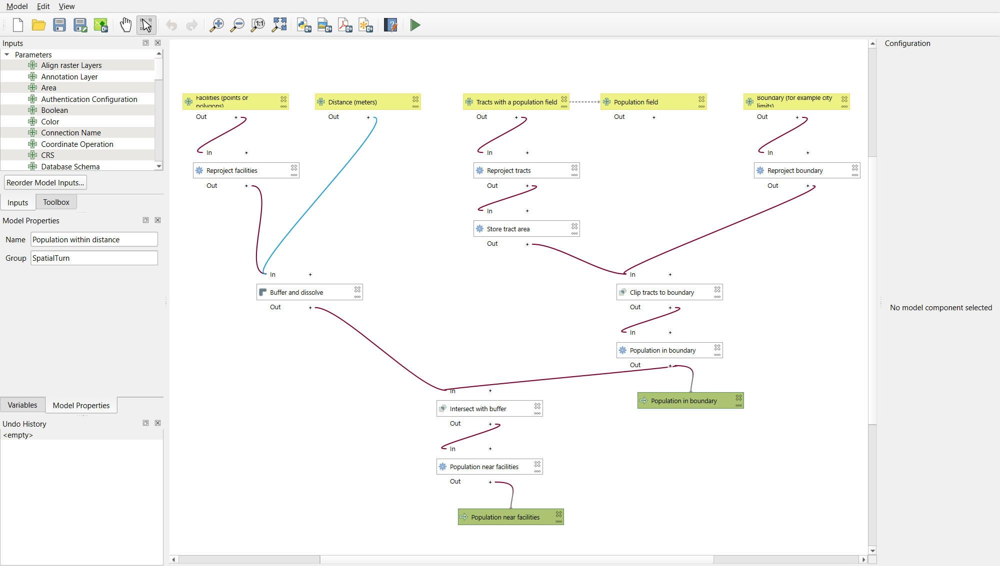
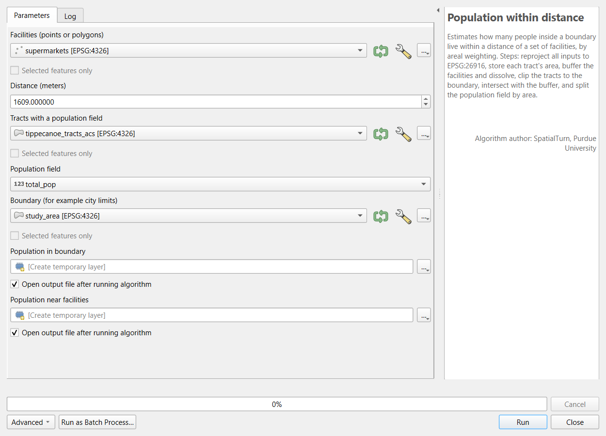
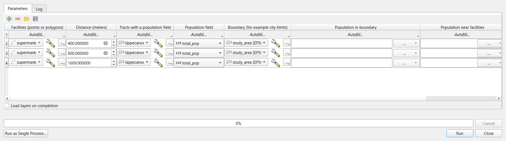

:::::::::::::::::::::::::::::::::::::: questions

- When is it worth automating a processing workflow?
- How do I record, repeat and package processing steps in QGIS?
- How do I make an automated workflow trustworthy?

::::::::::::::::::::::::::::::::::::::::::::::::

::::::::::::::::::::::::::::::::::::: objectives

- Find and rerun earlier tools with the Processing History
- Build a model in the Model Designer with inputs, algorithms and outputs
- Test the model against a known result, then run it as a batch for several distances
- Reuse the model for other facilities and other population fields

::::::::::::::::::::::::::::::::::::::::::::::::

## When to automate

The Geoprocessing episode answered one question: how many people in Lafayette and West Lafayette live within
1 mile of a supermarket? Real projects rarely stop at one answer. A reviewer asks about half a mile; a partner
asks about parks; next year's ACS data arrives; a colleague wants the same numbers for another county. Each
request means running the same steps again with one input changed.

Doing that by hand is slow, but the bigger problem is **mistakes**: a step skipped, an old layer selected in a
drop-down list, a distance typed as 1690 instead of 1609. Automation means writing the steps down once, in a form
the computer can repeat exactly, with the parts that change made into **parameters**.

A useful rule of thumb: the first time, do it by hand and understand it; the second time, notice you are
repeating yourself; the third time, automate. A one-off task is often not worth automating, but it is still
worth recording (see the [Introduction](introduction.md)).

## Levels of automation

| Level | Python | QGIS | Good for |
|---|---|---|---|
| **Record** | The notebook itself | **Processing > History**; a tool's **Advanced > Copy as Python Command** | Seeing exactly what was run, with which settings |
| **Repeat one tool** | A `for` loop around one function call | **Run as Batch Process** (one row per run) | The same tool on many inputs or settings |
| **Package several steps** | A **function** with parameters | A **model** in the Model Designer | A workflow you will run again with different inputs |
| **Run for every feature** | A loop over `groupby` groups or rows | The **Iterate** button (green arrows) next to an input layer | One output per county, per city, per study area |
| **Run without you** | A script run on a schedule or a server | `qgis_process` on the command line | Regular updates, very large jobs |

This episode covers the first four. The two tools mirror each other closely: a Python function and a QGIS model are
both "these steps, with these inputs"; a loop and a batch run are both "again, for each of these".

## Writing steps you can trust

Automated steps run without anyone watching, so they need habits that manual work can do without:

- **Test on a known answer.** Before running a function or model on new inputs, run it on a case you have
  already worked out by hand. Here: 77,473 people within 1 mile of a supermarket, from the Geoprocessing episode.
  If it does not match, find out why before going further.
- **Make the parameters explicit.** Every value that might change (a distance, a layer, a column) becomes a
  parameter with a clear name and, if there is a usual value, a default. Values that should *not* change (the
  projected CRS, the number of buffer segments) stay inside.
- **Check inputs and fail loudly.** A workflow that silently buffers in degrees is worse than one that stops with
  a message. Check the things that commonly go wrong (CRS, expected columns, row counts) at the start, or make the
  workflow fix them itself (the QGIS model reprojects every input).
- **Report what happened.** Print or log the number of rows read, codes replaced, features joined and features
  written. These counts are your evidence that each run worked.
- **Never overwrite inputs.** Write results to new layers or files with systematic names (`near_400.gpkg`,
  `near_800.gpkg`), so a rerun cannot destroy the raw data or an earlier result.
- **Keep one failure from stopping everything, but do not hide it.** When looping over 92 counties, catch an error
  for one county, record it and move on, then read the list of failures at the end.

## Summaries over many units

Running the same summary for every county raises a classic question: how do you combine tract values into a
county value? Add up **counts** first, then compute rates from the sums (households without a car divided by all
households). Averaging tract percentages gives a small rural tract the same weight as a large urban one and
answers a different question. Medians cannot be added up at all: a county median income must come from the
county-level ACS table, not from the tract medians.

::::::::::::::::::::::::::::::::::::: callout

## The same automation in Python

The [Automating Repeated Steps in Python](automating-python.md) episode writes the same workflow as a function and
runs it in a loop, with the same results. It also cleans the ACS table for all of Indiana and summarizes all 92
counties, a task that shows where code is the better tool.

::::::::::::::::::::::::::::::::::::::::::::::::

## Hands-on

These steps were checked in QGIS 4.0; the Model Designer looks the same in QGIS 3.34 and later. The workflow
packaged here is the one from the Geoprocessing in QGIS episode (Parts 2 to 8): reproject, store tract areas,
buffer and dissolve, clip, intersect and split the population by area.

### Part 1: Load the inputs

Add these four layers with **Layer > Add Layer > Add Vector Layer**, **Protocol: HTTP(S), cloud, etc.**,
**Type: HTTP/HTTPS/FTP**:

| Layer | File |
|---|---|
| Grocery stores | `grocery_stores.geojson` |
| City limits | `study_area.geojson` |
| Tracts with ACS data | `tippecanoe_tracts_acs.geojson` |
| Parks | `tippecanoe_parks.geojson` |

Web addresses to copy:

- **Grocery stores**: `https://raw.githubusercontent.com/SpatialTurn/CaseStudies/main/data/grocery_stores.geojson`
- **City limits**: `https://raw.githubusercontent.com/SpatialTurn/CaseStudies/main/data/study_area.geojson`
- **Tracts with ACS data**: `https://raw.githubusercontent.com/SpatialTurn/Foundations/main/data/tippecanoe_tracts_acs.geojson`
- **Parks**: `https://raw.githubusercontent.com/SpatialTurn/Foundations/main/data/tippecanoe_parks.geojson`

Then run **Extract by attribute** on `grocery_stores` (`store_type` `=` `Supermarket`) and rename the result
`supermarkets` (17 points).

### Part 2: The Processing History

Open **Processing > History**. Every tool you have run is listed with its exact settings, newest first, grouped
by date. Double-click the **Extract by attribute** entry: the tool opens again with the same settings, ready to
run with a change. Each tool dialog also has **Advanced > Copy as Python Command**, which copies the step as one
line of PyQGIS code. Together they mean nothing you run in the Processing Toolbox is ever lost; the History is
the first place to look when you need to write up your methods.

### Part 3: Build a model

The **Model Designer** chains tools into a new tool of your own. Open it with **Processing > Model Designer**.

1. In **Model Properties** (left), set **Name** `Population within distance` and **Group** `SpatialTurn`.
2. Add the **inputs** from the **Inputs** tab by dragging each onto the canvas (or double-clicking it):

   | Input type | Description | Settings |
   |---|---|---|
   | **Vector Features** | `Facilities (points or polygons)` | Geometry type: any |
   | **Number** | `Distance (meters)` | Number type: Float, default `1609` |
   | **Vector Features** | `Tracts with a population field` | Geometry type: polygon |
   | **Field** | `Population field` | Parent layer: Tracts; field type: Numeric; default `total_pop` |
   | **Vector Features** | `Boundary (for example city limits)` | Geometry type: polygon |

3. Add the **algorithms** from the **Toolbox** tab, in this order. In each dialog, choose the input from the
   drop-down list (the small button next to a parameter switches between a fixed value, a model input and an
   algorithm output):

   | Algorithm | Description | Settings |
   |---|---|---|
   | Reproject layer | Reproject facilities | Input: the *Facilities* input; Target CRS: EPSG:26916 |
   | Reproject layer | Reproject tracts | Input: *Tracts*; EPSG:26916 |
   | Reproject layer | Reproject boundary | Input: *Boundary*; EPSG:26916 |
   | Field calculator | Store tract area | Input: output of *Reproject tracts*; field `tract_m2`, Decimal; formula `area($geometry)` |
   | Buffer | Buffer and dissolve | Input: output of *Reproject facilities*; Distance: the *Distance* input; Segments 16; **Dissolve result** ticked |
   | Clip | Clip tracts to boundary | Input: output of *Store tract area*; Overlay: output of *Reproject boundary* |
   | Field calculator | Population in boundary | Input: output of *Clip*; field `pop_in_boundary`, Decimal; formula `area($geometry) / "tract_m2" * attribute(@populationfield)`; type a name in its output box to make it a model output: `Population in boundary` |
   | Intersection | Intersect with buffer | Input: output of *Population in boundary*; Overlay: output of *Buffer and dissolve* |
   | Field calculator | Population near facilities | Input: output of *Intersect*; field `pop_near`, Decimal; formula `area($geometry) / "tract_m2" * attribute(@populationfield)`; model output `Population near facilities` |

   Inside a model every input is also a variable, named after its description without spaces, punctuation or
   capitals: the *Population field* input is `@populationfield`. `attribute()` reads the field with that name, which is what lets the same model count residents,
   children or households.
4. Save the model (**Model > Save Model**). It now appears in the Processing Toolbox under **Models**.

{alt="Screenshot of the QGIS Model Designer with the Population within distance model, group SpatialTurn. Five yellow input boxes across the top: Facilities (points or polygons), Distance (meters), Tracts with a population field, Population field (linked to the tracts by a dashed line) and Boundary. Below them, white algorithm boxes connected by curved lines: Reproject facilities leads, together with Distance, to Buffer and dissolve; Reproject tracts leads to Store tract area; Store tract area and Reproject boundary lead to Clip tracts to boundary, then Population in boundary; Population in boundary and Buffer and dissolve lead to Intersect with buffer, then Population near facilities. Two green output boxes are attached: Population in boundary and Population near facilities."}

If you are short of time, or want to compare with your own, download the finished model from
`https://raw.githubusercontent.com/SpatialTurn/DataProcessing/main/data/population_within_distance.model3` (save the page as a file), then in the Processing Toolbox click the
**Models** button (three gears) > **Add Model to Toolbox**.

::::::::::::::::::::::::::::::::::::: callout

### Why does the model reproject everything?

The Geoprocessing episode showed what happens when a layer in degrees is buffered by 1,609: the "buffer" covers
the whole Earth. Instead of hoping every user remembers to reproject first, the model does it itself. This is the
QGIS version of "check inputs and fail loudly": make the common mistake impossible.

::::::::::::::::::::::::::::::::::::::::::::::::

### Part 4: Test the model on a known answer

1. Run the model from the Processing Toolbox (**Models > SpatialTurn > Population within distance**) with
   **Facilities** `supermarkets`, **Distance** `1609`, **Tracts** `tippecanoe_tracts_acs`, **Population field**
   `total_pop` and **Boundary** `study_area`. Leave both outputs as temporary layers.

   {alt="Screenshot of the dialog for the Population within distance model. Facilities (points or polygons) is supermarkets, Distance (meters) is 1609, Tracts with a population field is tippecanoe_tracts_acs, Population field is total_pop, Boundary is study_area, and the outputs Population in boundary and Population near facilities are temporary layers. The help panel on the right describes the model's steps and names SpatialTurn, Purdue University, as its author."}
2. Select all features of **Population near facilities** and look at the **Statistics** panel for `pop_near`:
   the sum is **77,473**. For **Population in boundary**, the sum of `pop_in_boundary` is **114,345**.

These are exactly the Geoprocessing episode's numbers (67.8%). Only now is the model ready for new questions.

### Part 5: Run it as a batch

1. Right-click the model in the Toolbox and choose **Execute as Batch Process** (or click **Run as Batch
   Process** in its dialog).
2. Click the green **+** to make three rows. In the first row set the four layers and the field; then use
   **Autofill... > Fill Down** in each of those columns to copy them to the other rows.
3. Type the distances **400**, **800** and **1609**.
4. In each output column, type a layer name (`near_400`, `near_800`, `near_1609`; `city_400` and so on for the
   other output) and choose **Create Temporary Layer** from its **...** menu, or save to files instead (**Save to
   File...**; its **Fill with parameter values** option builds the names from the Distance column). Tick **Load
   layers on completion**, then **Run**.

   {alt="Screenshot of the QGIS batch processing dialog for the model. Three rows, one per run, with columns Facilities (supermarkets), Distance (400, 800 and 1609), Tracts with a population field (tippecanoe_tracts_acs), Population field (total_pop), Boundary (study_area), and two output columns, Population in boundary and Population near facilities, still empty. Each column header has an Autofill menu. A checkbox at the bottom reads Load layers on completion."}

**Check:** the sums of `pop_near` are about 7,900 (400 m), 26,600 (800 m) and 77,500 (1 mile): **6.9%**,
**23.2%** and **67.8%** of the 114,345 residents.

### Part 6: Reuse the model

Run the model again, changing only the inputs:

- **Facilities** `tippecanoe_parks`, **Distance** `800`: about **81,800** residents, **71.5%**, live within 800 m
  of a park (polygons are buffered from their edges).
- **Facilities** `supermarkets`, **Distance** `1609`, **Population field** `pop_under18`: about **14,800** of
  **19,540** children, **75.7%**.

Two new answers, with no new geoprocessing by hand.

::::::::::::::::::::::::::::::::::::: callout

### One output per feature: the Iterate button

Many Processing tools show a small green **Iterate over this layer** button (two curved arrows) next to an input
layer. With it ticked, the tool runs once for **every feature** of that layer and writes a separate output for
each: for example, **Clip** tracts with a counties layer, iterating over the counties, gives one tract layer per
county. Select a few features first (and tick **Selected features only**) to keep the number of outputs small.

::::::::::::::::::::::::::::::::::::::::::::::::

:::::::::::::::::::::::::::::::::::: challenge

## Challenge 1: Batch, model or iterate?

Which QGIS tool would you use?

1. Reproject twelve layers to EPSG:26916.
2. Every month, rerun a five-step workflow on a new file of reported potholes.
3. Make one map layer of tracts for each of the 92 Indiana counties.

:::::::::::::::: solution

1. **Batch processing** of Reproject Layer: one tool, twelve rows (Autofill fills the CRS down).
2. A **model**: several steps in a fixed order, with the new file as an input. Save it so next month's run
   takes one dialog.
3. **Iterate over this layer** on the counties input of Clip (or Extract by Location): one output per feature.

:::::::::::::::::::::::::

::::::::::::::::::::::::::::::::::::::::::::::::

:::::::::::::::::::::::::::::::::::: challenge

## Challenge 2: Parameter or not?

You are turning the park access analysis into a model. Which of these should be model inputs, and which should
be fixed inside the model? The parks layer; the walking distance; the projected CRS; the population field; the
number of buffer segments.

:::::::::::::::: solution

The **parks layer**, the **distance** (default 800) and the **population field** (default `total_pop`) are
inputs: they are the things you will change. The **CRS** and the **number of segments** stay fixed inside, so
every run is done the same way and results stay comparable.

:::::::::::::::::::::::::

::::::::::::::::::::::::::::::::::::::::::::::::

:::::::::::::::::::::::::::::::::::: challenge

## Challenge 3: A suspicious result

A classmate's version of the model reports that 100% of residents live within 800 m of a supermarket. Their model
has no Reproject steps, and their supermarkets layer is in EPSG:4326. What happened?

:::::::::::::::: solution

Without reprojection, Buffer uses the layer's units: 800 **degrees**, which covers the whole planet, so every tract
is "near". The fix is the one in this model: reproject inside the model (or check the CRS and stop). Testing the
model on the known 1-mile answer first would have caught the problem before any new results were reported.

:::::::::::::::::::::::::

::::::::::::::::::::::::::::::::::::::::::::::::

::::::::::::::::::::::::::::::::::::: keypoints

- Automate work you will repeat; record work you will not (Processing > History)
- A model packages several tools; its inputs are the parts that change
- Test a model on a known answer before using it on new questions
- Run as Batch Process repeats a tool or model with different settings, one row per run
- Iterate over this layer runs a tool once per feature
- Make common mistakes impossible inside the model, for example by reprojecting every input

::::::::::::::::::::::::::::::::::::::::::::::::
