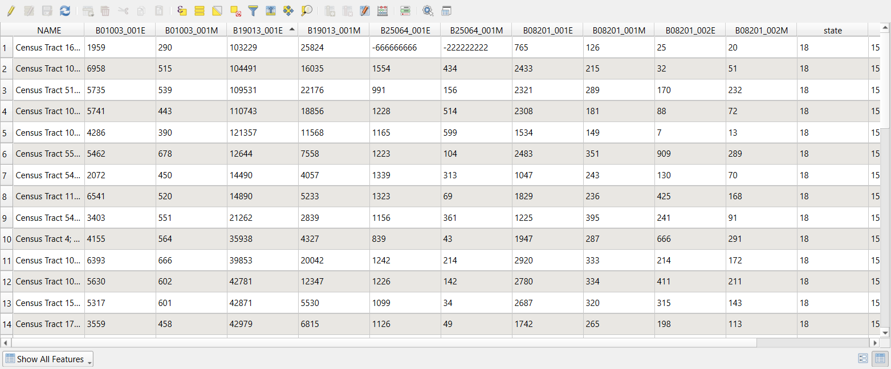
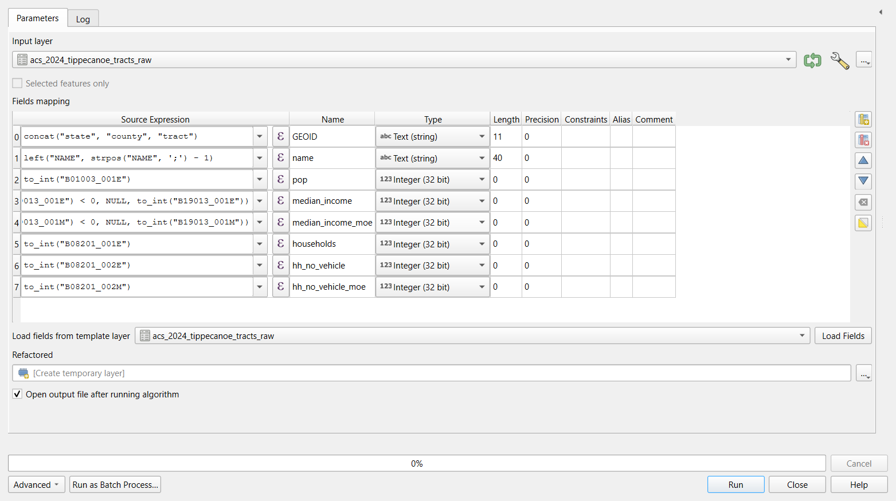
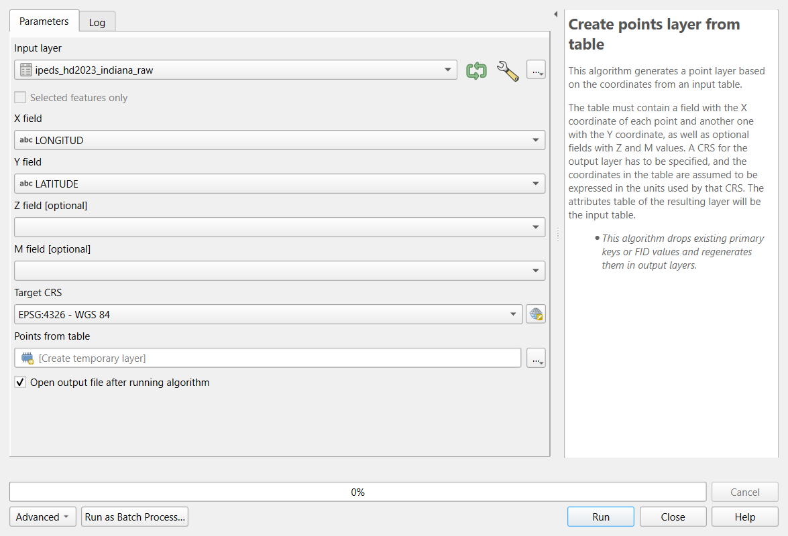
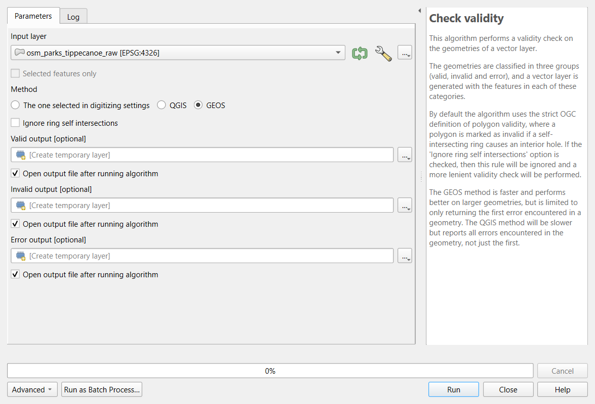

:::::::::::::::::::::::::::::::::::::: questions

- What goes wrong when raw data is used as it was downloaded?
- How do I fix types, identifiers, special codes, duplicates and geometry problems in QGIS?
- How reliable is an American Community Survey estimate?

::::::::::::::::::::::::::::::::::::::::::::::::

::::::::::::::::::::::::::::::::::::: objectives

- Recognize the common problems of raw tables and layers, and choose a fix for each
- Use Refactor Fields to rename fields, set their types, build a GEOID and turn special codes into NULL
- Judge the reliability of ACS estimates with the coefficient of variation
- Create points from a table of coordinates and find records that share a location
- Check geometry validity, remove unwanted features, dissolve split features and confirm each step

::::::::::::::::::::::::::::::::::::::::::::::::

## Why cleaning comes first

Every downloaded dataset carries the habits of the system that produced it: the Census Bureau's codes for "no
estimate", a federal directory's codes for "not applicable", a volunteer map's unnamed and split features. None of
these are errors in the source; they are conventions you have to know. But if you analyze the data without
handling them, the software treats a code as a number, a split park as two parks, and a missing identifier as a
mismatch, and it does so **without any warning**.

This episode cleans three raw files you will meet again later in the curriculum:

| File | Raw problems you will fix |
|---|---|
| ACS 2024 table for the 43 census tracts of Tippecanoe County, exactly as the Census API returned it | Identifiers split in three parts; numbers or text depending on the tool; codes such as -666666666; margins of error; a tract with no households |
| IPEDS directory of the 105 colleges and schools in Indiana (2023) | Coordinates in two columns; numeric category codes; `-2` for "not applicable"; ZIP and ZIP+4 mixed; two pairs of colleges at the same address |
| OpenStreetMap parks in Tippecanoe County, one feature per OSM object | Unnamed features; parks split into two features; possible invalid geometries |

## The common problems

| Problem | What it looks like | Why it matters | Fix |
|---|---|---|---|
| **Identifiers read as numbers** | Tract `000100` becomes `100`; ZIP `02138` becomes `2138` | Joins fail or match the wrong rows | Read the column as text; rebuild with padding (`zfill`, `lpad`) |
| **Numbers read as text** | `"53488"` sorts before `"9000"`; sums are impossible | Sorting, statistics and maps go wrong | Convert the type (`to_numeric`, `to_int`) |
| **Codes that mean "missing"** | `-666666666`, `-2`, `9999`, `NA`, an empty string | Averages and maps include impossible values | Turn them into real missing values (`NaN`, `NULL`) and count them |
| **Categories stored as codes** | `SECTOR = 2` | Unreadable tables and legends | Recode with the codebook (data dictionary) |
| **Messy text** | Trailing spaces, `Purdue Univ.` and `Purdue University` | Groups and joins split one thing into two | `strip`/`trim`, consistent case, a lookup table |
| **Duplicates** | The same record twice, or two features for one object | Counts and totals inflated | Decide what makes two records the same (an ID), then remove or merge |
| **Invalid geometry** | A polygon whose edges cross itself | Overlays fail or give wrong areas | Check validity; repair with `make_valid` or Fix Geometries |
| **Wrong or missing CRS** | Points near (0, 0), or a layer that lands in the ocean | Everything spatial is wrong | *Define* the CRS the coordinates are really in, then *reproject* |

Two fixes in that table are easy to confuse. **Defining** a CRS tells the software what the coordinates already
are (it changes no numbers); **reprojecting** converts the coordinates to another CRS (every number changes). If a
layer has no CRS, define it; if it has the right CRS but you need meters, reproject it. Defining the wrong CRS
moves the layer to the wrong place on Earth.

## Census annotation codes

The Census Bureau's API returns numbers in every estimate column, so where no estimate exists it writes a large
negative **annotation code** instead:

| Code | Meaning |
|---|---|
| `-666666666` | The estimate could not be computed (too few sample cases, or nothing to compute, such as median household income where there are no households) |
| `-999999999` | The estimate or margin of error cannot be shown (too few sample cases) |
| `-888888888` | Not applicable |
| `-222222222` | The margin of error could not be computed (too few sample observations) |
| `-333333333` | The margin of error could not be computed, because the median is in an open-ended top or bottom range (median income `250001` means "$250,000 or more") |
| `-555555555` | The estimate is controlled (fixed by design), so its margin of error is zero |

In Tippecanoe County, Census Tract 104 has 8,248 residents and **no households**: it is the Purdue residence
halls, where everyone lives in group quarters. Its median household income and median rent are both
`-666666666`, and any rate with households as the denominator is undefined (a division by zero). Two other tracts
have too few sample cases for one of the medians.

## Margins of error and reliability

The American Community Survey asks a sample of households, so every number is an **estimate** with a **margin of
error (MOE)**: with 90% confidence the true value lies between estimate minus MOE and estimate plus MOE. To
compare how reliable different estimates are, divide the standard error (MOE / 1.645) by the estimate:

$$CV = \frac{MOE / 1.645}{\text{estimate}} \times 100$$

The **coefficient of variation (CV)** is the error as a percentage of the estimate. A widely used rule of thumb:
under 12% is high reliability, 12 to 40% medium, over 40% low.

Small counts are the usual problem. In Tippecanoe County, median household income has medium or high
reliability in every tract, but the number of **households without a car** has a CV over 40% in 25 of the 42
tracts that have households. That does not make the variable useless, but it limits what you can say: map it in
a few broad classes, add up tracts into larger areas, report the margins, and do not rank single tracts.

## Rows you remove are decisions

Cleaning includes choices that are not fixes: keeping only degree-granting colleges, dropping unnamed park
features, leaving out the residence-hall tract from a rate. Each is reasonable, and each changes the result.
Write them down, with the number of rows affected, in your processing log (see the
[Introduction](introduction.md)).

## Check after every step

| Step | Check |
|---|---|
| Reading the file | Row count matches the source (43 tracts, 105 institutions, 80 park features) |
| Fixing identifiers | GEOIDs have 11 characters; every row joins to a boundary |
| Turning codes into missing | Count of codes before (8) and after (0); count of missing values |
| Filtering and merging | Rows before and after (105 to 70 colleges; 80 to 70 to 68 parks) |
| Making points | The points land in Indiana, in the county their record names |
| Comparing with a trusted copy | The cleaned files match those the Foundations module uses |

::::::::::::::::::::::::::::::::::::: callout

## The same cleaning in Python

The [Cleaning and Preparing Data in Python](cleaning-python.md) episode cleans the same three files with pandas
and GeoPandas and reaches the same numbers. One difference is worth knowing: pandas guesses types and reads the
tract code `000100` as the number 100, while QGIS (reading the CSV through the web) reads **every** column as
text. The problems are opposite, and so are the fixes.

::::::::::::::::::::::::::::::::::::::::::::::::

## Hands-on

These steps were checked in QGIS 4.0; in QGIS 3.34 and later the tools are the same. Keep the **Processing
Toolbox** open (**Processing > Toolbox**) and use its search box to find each tool.

Add every layer with **Layer > Add Layer > Add Vector Layer**, **Source Type: Protocol: HTTP(S), cloud, etc.**,
**Type: HTTP/HTTPS/FTP** (in QGIS 4 the Type list starts with cloud services, so check it), as in the
Foundations QGIS episodes. A CSV loaded this way has no geometry: it appears in the Layers panel as a table.

### Part 1: Inspect the raw Census table

1. Add `https://raw.githubusercontent.com/SpatialTurn/DataProcessing/main/data/acs_2024_tippecanoe_tracts_raw.csv`.
2. Open its attribute table. Click the `B19013_001E` header (median household income) to sort by it.

   {alt="Screenshot of the QGIS attribute table of acs_2024_tippecanoe_tracts_raw with columns NAME, B01003_001E, B01003_001M, B19013_001E, B19013_001M, B25064_001E, B25064_001M, B08201_001E, B08201_001M, B08201_002E, B08201_002M and state. The table is sorted by B19013_001E, and the order is that of text, not numbers: 103229, 104491, 109531, 110743, 121357, 12644, 14490, 14890, 21262, 35938, 39853, 42781 and so on. In the first row, B25064_001E reads -666666666 and B25064_001M reads -222222222."}

The sort is alphabetical: `121357` comes before `12644` because QGIS read **every column as text**. (The
`state`, `county` and `tract` columns are text too, which is what we want for them: `000100` keeps its zeros.)
Scroll down and you will also find the codes `-666666666` and `-222222222`.

**Check:** 43 rows, one per tract; **Layer Properties > Fields** lists every field as **String**.

### Part 2: Refactor the fields

**Refactor Fields** makes a new layer in which you choose each field's name, type and contents (an expression),
all in one table. The original layer is not changed.

1. Processing Toolbox: **Refactor fields**. **Input layer:** `acs_2024_tippecanoe_tracts_raw`. The table lists the
   14 original fields.
2. Delete every row (select them all in the table and click **Delete selected field**), then add rows with the
   **Add new field** button until you have these eight. Type each **Source Expression** (or open the ε button to
   use the expression builder), then set **Name** and **Type**:

   | Source expression | Name | Type |
   |---|---|---|
   | `concat("state", "county", "tract")` | `GEOID` | Text (string) |
   | `left("NAME", strpos("NAME", ';') - 1)` | `name` | Text (string) |
   | `to_int("B01003_001E")` | `pop` | Integer (32 bit) |
   | `if(to_int("B19013_001E") < 0, NULL, to_int("B19013_001E"))` | `median_income` | Integer (32 bit) |
   | `if(to_int("B19013_001M") < 0, NULL, to_int("B19013_001M"))` | `median_income_moe` | Integer (32 bit) |
   | `to_int("B08201_001E")` | `households` | Integer (32 bit) |
   | `to_int("B08201_002E")` | `hh_no_vehicle` | Integer (32 bit) |
   | `to_int("B08201_002M")` | `hh_no_vehicle_moe` | Integer (32 bit) |

   `concat()` joins text, `to_int()` turns text into a whole number, and `if(condition, NULL, value)` replaces a code with
   NULL, QGIS's missing value. `left()` and `strpos()` keep the part of the name before the first semicolon.

   {alt="Screenshot of the QGIS Refactor fields tool. Input layer is acs_2024_tippecanoe_tracts_raw. The Fields mapping table has eight rows with columns Source Expression, Name, Type, Length and Precision: concat of state, county and tract as GEOID, Text (string), length 11; left of NAME up to the semicolon as name, Text (string), length 40; to_int of B01003_001E as pop, Integer (32 bit); an if expression on B19013_001E as median_income and on B19013_001M as median_income_moe, both Integer (32 bit); and to_int of B08201_001E, B08201_002E and B08201_002M as households, hh_no_vehicle and hh_no_vehicle_moe, all Integer (32 bit). The output, Refactored, is a temporary layer."}
3. Leave **Refactored** as a temporary layer, click **Run**, and rename the result `acs_clean`.

**Check:** open the attribute table of `acs_clean`. Numbers are now right-aligned and sort as numbers; `GEOID`
reads `18157000100` for tract 1; `median_income` is **NULL** in two rows (tracts 104 and 105). Sorting by
`median_income` puts the lowest real income, 12,644, at the top.

::::::::::::::::::::::::::::::::::::: callout

### Save the mapping

The **...** button beside the fields table (or the **Load Fields** template option) lets you reuse a mapping. For
a task you will repeat, the Automating Repeated Steps episode shows how to keep the whole chain of tools as a
model.

::::::::::::::::::::::::::::::::::::::::::::::::

### Part 3: Reliability and a safe rate

`acs_clean` is a temporary layer, so its Field Calculator can add real fields.

1. Open the attribute table of `acs_clean` and the **Field Calculator** (abacus icon). Create these fields one at a
   time, each a **Decimal number (real)** unless stated:

   | Field | Expression |
   |---|---|
   | `income_cv` | `round(("median_income_moe" / 1.645) / "median_income" * 100, 1)` |
   | `income_rel` (Text) | `CASE WHEN "income_cv" < 12 THEN 'high' WHEN "income_cv" < 40 THEN 'medium' WHEN "income_cv" >= 40 THEN 'low' END` |
   | `no_vehicle_cv` | `round(("hh_no_vehicle_moe" / 1.645) / nullif("hh_no_vehicle", 0) * 100, 1)` |
   | `pct_no_vehicle` | `round("hh_no_vehicle" / nullif("households", 0) * 100, 1)` |

   `nullif(x, 0)` returns NULL when `x` is 0, so a division by zero gives NULL instead of an error.
2. Click the pencil icon to stop editing, and save.

**Check:** in the **Statistics** panel (**View > Panels > Statistics**) or by sorting:

- `income_rel` is **high** in 21 tracts and **medium** in 20 (2 are NULL);
- `no_vehicle_cv` is 40 or more in **25** tracts: most counts of households without a car are too uncertain to rank;
- `pct_no_vehicle` is NULL only for tract 104 (no households) and ranges from 0.2 to 40.7.

### Part 4: Join to the boundaries and check the matches

1. Add `https://raw.githubusercontent.com/SpatialTurn/Foundations/main/data/tippecanoe_tracts.geojson`.
2. Processing Toolbox: **Join attributes by field value**. **Input layer:** `tippecanoe_tracts`, **Table field:**
   `GEOID`; **Input layer 2:** `acs_clean`, **Table field 2:** `GEOID`; **Join type:** take attributes of the first
   matching feature only. Run.
3. Open the **Log** tab of the tool's dialog (or the Processing log) before closing it.

**Check:** the log says "43 features from input layer were successfully matched", and its Results line shows
`'UNJOINABLE_COUNT': 0`. If the GEOID had lost its zeros, or one side
were text and the other a number, this is where you would see it. Style the result by `median_income` (with
**Symbology > Graduated**): the two NULL tracts are not drawn, so add a gray layer of the boundaries underneath to
show them.

### Part 5: Colleges from a table of coordinates

1. Add `https://raw.githubusercontent.com/SpatialTurn/DataProcessing/main/data/ipeds_hd2023_indiana_raw.csv` (105 rows) and look at the attribute table: `CLOSEDAT` reads
   `-2` followed by spaces, ZIP codes mix `47306` and `47374-4019`, and `SECTOR` holds codes 1 to 9.
2. Processing Toolbox: **Create points layer from table**. **X field:** `LONGITUD` (x is longitude), **Y field:**
   `LATITUDE`, **Target CRS:** `EPSG:4326 - WGS 84` (the coordinates are in degrees). Run, and rename the result
   `colleges_points`.

   {alt="Screenshot of the QGIS Create points layer from table tool. Input layer is ipeds_hd2023_indiana_raw, X field is LONGITUD and Y field is LATITUDE (both text fields), Z and M fields are empty, Target CRS is EPSG:4326 - WGS 84, and the output is a temporary layer. The help panel says the coordinates in the table are assumed to be expressed in the units of the CRS."}
3. **Extract by attribute**: **Input layer** `colleges_points`, **Selection attribute** `DEGGRANT`, **Operator** `=`,
   **Value** `1`. Rename the result `colleges`.

**Check:** 105 points, all inside Indiana; **70** degree-granting colleges.

### Part 6: Same place, same college?

1. With `colleges` selected in the Layers panel, click **Select Features by Expression** (the ε icon with a
   yellow square) and enter:

   ```
   count(@id, group_by := geom_to_wkt($geometry)) > 1
   ```

   It counts the features at each exact location and selects those that share one.
2. Click **Select Features**, then open the attribute table and choose **Show Selected Features**.

**Check:** 4 selected: Trine University and its regional campus, and Indiana Institute of Technology and its
College of Professional Studies. They are four different institutions (four different `UNITID`s) at two
addresses. QGIS's **Delete duplicate geometries** tool would remove two of them, so do not use it here.

3. For a last check, run **Join attributes by location**: **Join to features in** `colleges`, **where the
   features** are **within**, **by comparing to** the Indiana counties
   (`https://raw.githubusercontent.com/SpatialTurn/Foundations/main/data/indiana_counties.geojson`), fields to add: `fips`. In the result, **Select by Expression**
   `"fips" <> "COUNTYCD"`: 0 features. Every college lies in the county its record names.

### Part 7: Parks from OpenStreetMap

1. Add `https://raw.githubusercontent.com/SpatialTurn/DataProcessing/main/data/osm_parks_tippecanoe_raw.geojson`: **80** features.
2. Processing Toolbox: **Check validity**. **Input layer:** the parks; **Method:** GEOS. Run.

   {alt="Screenshot of the QGIS Check validity tool in dark mode. Input layer is osm_parks_tippecanoe_raw in EPSG:4326, Method is GEOS, Ignore ring self intersections is unchecked, and Valid output, Invalid output and Error output are temporary layers. The help panel explains that geometries are classified as valid, invalid or error, and that the GEOS method returns only the first error in a geometry while the QGIS method reports all of them."}

   **Check:** the **Valid output** has 80 features, the **Invalid output** 0. If there were invalid features,
   **Fix geometries** would repair them; check the repaired shapes on the map.
3. **Extract by expression**: `"name" IS NOT NULL`. **Check:** 70 features (10 unnamed removed).
4. **Vector > Geoprocessing Tools > Dissolve**, **Dissolve field(s):** `name`. **Check:** **68** parks: McAllister
   Park and Triangle Park, each mapped as two features, are now one.
5. **Reproject Layer** to **EPSG:26916**, and in the Field Calculator add `area_ha`, a decimal field,
   `area($geometry) / 10000`. **Check:** the largest is Ross Hills Park, about **143.5 ha**, then McAllister Park,
   about 105 ha.

The result has the same 68 parks as the parks file the Foundations and Case Studies modules use.

:::::::::::::::::::::::::::::::::::: challenge

## Challenge 1: The rent columns

Run **Refactor fields** on the raw table again, this time adding `median_rent` and `median_rent_moe` from
`B25064_001E` and `B25064_001M` (with the same `if(... < 0, NULL, ...)` pattern). How many tracts have no rent
estimate, and which?

:::::::::::::::: solution

Two: tract 16.01 (too few renters in the sample) and tract 104 (no households). Their raw values are
`-666666666` (estimate) and `-222222222` (margin of error). The Refactor Fields dialog remembers its last
mapping, so you only add two rows.

:::::::::::::::::::::::::

::::::::::::::::::::::::::::::::::::::::::::::::

:::::::::::::::::::::::::::::::::::: challenge

## Challenge 2: Rank the tracts?

A news story wants to name "the five tracts in Tippecanoe County with the most households without a car". In
`acs_clean`, sort by `hh_no_vehicle`: tracts 55 (909, MOE 289), 4 (666, MOE 291), 112 (425, MOE 168), 102.08
(411, MOE 211) and 111 (384, MOE 179). Is the ranking sound?

:::::::::::::::: solution

Not as a strict ranking. Tract 111 could have as many as 384 + 179 = 563 households without a car and tract 4 as
few as 666 - 291 = 375, so second and fifth place could swap, and places 3 to 5 are hard to tell apart. The sixth
tract (7, with 341 plus or minus 164) could belong in the list too. Say that these tracts have *among the highest*
numbers and report the margins.

:::::::::::::::::::::::::

::::::::::::::::::::::::::::::::::::::::::::::::

:::::::::::::::::::::::::::::::::::: challenge

## Challenge 3: Define or reproject?

You receive a CSV of community centers with columns `x` and `y` holding values such as `506512` and `4475023`, and
the provider says they are "UTM zone 16N, NAD83". What do you choose in **Create points layer from table**?

:::::::::::::::: solution

The values are meters, so the **Target CRS** is **EPSG:26916** (NAD83 / UTM zone 16N): that *defines* what the
coordinates are. Choosing EPSG:4326 would place the points at longitude 506,512, which does not exist. If you later
need degrees, **Reproject Layer** converts them.

:::::::::::::::::::::::::

::::::::::::::::::::::::::::::::::::::::::::::::

::::::::::::::::::::::::::::::::::::: keypoints

- Inspect before changing anything: sorting a column quickly shows text that should be numbers and special codes
- Refactor Fields renames fields, sets their types and fills them with expressions in one step, without changing the original
- `to_int()`, `if(... < 0, NULL, ...)` and `nullif(x, 0)` handle text numbers, codes and division by zero
- ACS estimates have margins of error; the coefficient of variation shows which are too uncertain to rank
- Create points from coordinates with the CRS they are in; decide what makes two records the same before deleting
- Check validity, remove unwanted features and dissolve split ones, and confirm each step with a count

::::::::::::::::::::::::::::::::::::::::::::::::
