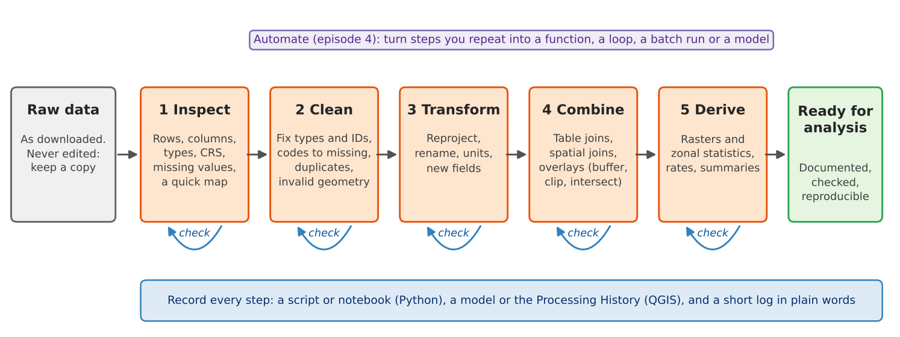

:::::::::::::::::::::::::::::::::::::: questions

- What happens to data between downloading it and analyzing it?
- Why should I never edit my raw data?
- How do I make my processing steps repeatable and easy to check?

::::::::::::::::::::::::::::::::::::::::::::::::

::::::::::::::::::::::::::::::::::::: objectives

- Describe the five stages of a processing workflow: inspect, clean, transform, combine and derive
- Explain why raw data is kept unchanged and how each step is recorded
- Choose a check that confirms a processing step did what you intended
- Find the right episode in this module for a processing task

::::::::::::::::::::::::::::::::::::::::::::::::

## From downloaded data to analysis-ready data

Data almost never arrives ready to analyze. A Census table stores its identifiers as numbers and
loses their leading zeros; a list of colleges marks missing values with `-2`; a parks layer from
OpenStreetMap contains a polygon that crosses itself; two layers use different coordinate systems.
**Data processing** is everything you do to turn the data you collected into data you can trust in an
analysis: cleaning it, putting it in the right shape and coordinate system, combining it with other data,
and deriving the measures your question needs.

Processing is not glamorous, and it is easy to underestimate. In most research projects it takes more time
than the analysis itself, and most mistakes that reach a published map or table were made here: a join that
silently dropped a third of the rows, a code for "not available" averaged in as a real number, a buffer of
1,609 degrees instead of 1,609 meters. This module teaches the everyday operations, and just as importantly
the habits that catch those mistakes.

{alt="Flow diagram. A gray box, raw data, as downloaded, never edited, keep a copy, leads to five orange boxes in a row: 1 Inspect (rows, columns, types, CRS, missing values, a quick map), 2 Clean (fix types and IDs, codes to missing, duplicates, invalid geometry), 3 Transform (reproject, rename, units, new fields), 4 Combine (table joins, spatial joins, overlays such as buffer, clip and intersect) and 5 Derive (rasters and zonal statistics, rates, summaries). Each orange box has a small blue looping arrow labeled check. The last arrow leads to a green box, ready for analysis: documented, checked, reproducible. Above the row, a purple note says: Automate (episode 4), turn steps you repeat into a function, a loop, a batch run or a model. Below the row, a blue bar says: record every step, a script or notebook (Python), a model or the Processing History (QGIS), and a short log in plain words."}

## The five stages

| Stage | What you do | Typical tools | Where in this module |
|---|---|---|---|
| **1 Inspect** | Look before you change anything: number of rows, column names and types, CRS, missing values, a quick map | `df.info()`, `.head()`, `.plot()`; QGIS attribute table, Layer Properties, Statistics panel | Cleaning |
| **2 Clean** | Fix what is wrong: identifiers stored as numbers, codes that mean "missing", duplicates, invalid geometries | `pandas`, `make_valid`; QGIS Field Calculator, Refactor Fields, Fix Geometries | Cleaning |
| **3 Transform** | Change the form without changing the meaning: reproject, rename, convert units, add calculated fields | `to_crs`, `rename`; Reproject Layer, Field Calculator | Cleaning, Geoprocessing |
| **4 Combine** | Bring data together: table joins, spatial joins and overlays (buffer, clip, intersect, dissolve) | `merge`, `sjoin`, `overlay`; Join Attributes, Vector > Geoprocessing Tools | Geoprocessing |
| **5 Derive** | Create the measures you will analyze: rates, densities, raster calculations, zonal statistics | `rasterio`, `rasterstats`; Raster Calculator, Zonal Statistics | Raster Processing |

Real work does not always run in this order. You may find a cleaning problem only after a join, or decide to
reproject before you clean. What matters is that every stage is done deliberately and checked.

## Rule 1: never edit the raw data

Keep the files exactly as you downloaded them, in a folder of their own (for example `data/raw/`), and write
everything you produce to another folder (`data/processed/`). If a step goes wrong, you start again from the
raw files instead of trying to undo a change you no longer remember. Editing the raw file in place, by
retyping a cell in a spreadsheet or by editing a layer in QGIS and saving it, destroys the evidence of what
the data originally said. The Data Management module's
[Organizing, Versioning and Backing Up](https://spatialturn.github.io/DataManagement/organizing.html) episode
describes folder layouts and naming in more detail.

In this curriculum the raw files live on GitHub and are read straight into memory, so you cannot damage them
by accident. Your own projects need the same protection.

## Rule 2: record every step

A processing step that is not written down cannot be checked, repeated or explained. How you record it depends
on the tool:

- **Python.** The notebook or script *is* the record. Run it from top to bottom on the raw data and you get
  the same result every time. Add a short comment or Markdown cell saying *why* each step is there.
- **QGIS.** Point-and-click work leaves no record by default, but QGIS keeps one for you if you use it:
  **Processing > History** lists every tool you ran with its exact settings, and a tool's
  **Advanced > Copy as Python Command** gives the same step as code. The **Graphical Modeler** saves a chain
  of tools as a model you can run again (episode 4).
- **Either tool.** Keep a short log in plain words (a text file or a few lines in your project notes): what
  you downloaded and when, what you removed or changed, and why. For example: "Dropped 2 tracts with no
  households (Purdue campus); median income set to missing in 3 tracts where the Census code was
  -666666666."

The log becomes the methods section of your report and the processing part of your metadata (see the Data
Curation module's [Documentation](https://spatialturn.github.io/DataCuration/documentation.html) episode).

## Rule 3: check after every step

Every step can fail silently: it runs without an error but does not do what you meant. A check is a quick
comparison between what you expected and what you got.

| After this step | Check |
|---|---|
| Reading a file | Number of rows and columns matches the source; identifiers look right (leading zeros kept) |
| Changing types or codes | Count of missing values before and after; minimum and maximum are plausible |
| Removing duplicates or rows | How many rows were removed, and are they the ones you meant? |
| Reprojecting | The layer still lands in the right place on a map; units are now meters |
| A table join | How many rows matched, and which did not? |
| An overlay or zonal statistics | Totals add up (population before and after), and a map of the result looks sensible |

A quick map is the most powerful check of all: a reprojection error, a shifted layer or a tract with an
impossible value is often obvious at a glance.

## Python or QGIS?

Every operation in this module exists in both tools, and each episode comes in a Python and a QGIS version
that use the same data and reach the same numbers.

- **QGIS** is quicker for a one-off task and lets you see each result immediately.
- **Python** is better when you will repeat the work: next year's data, another county, a reviewer asking you
  to change one step. The script records everything automatically.

Many projects use both: explore and check in QGIS, then write the final workflow in Python, or build it as a
QGIS model.

## In this module

| Episode | What you will learn |
|---|---|
| Cleaning and Preparing Data (Python or QGIS) | Read a raw Census table and a raw list of colleges, fix identifiers and types, turn codes into missing values, judge reliability, fix geometries and coordinate systems |
| Geoprocessing (Python or QGIS) | Buffers, selection by location, clip, intersect, dissolve, areal weighting and distances |
| Raster Processing (Python or QGIS) | Map algebra, reclassification, zonal statistics and dasymetric estimation |
| Automating Repeated Steps (Python or QGIS) | Functions and loops for many counties; batch processing and the Graphical Modeler in QGIS |

All episodes use data from Tippecanoe County, Indiana (Lafayette and West Lafayette), and Indiana as a whole.
The advanced methods (network analysis, spatial autocorrelation, clustering, NDVI) are in the
[Data Analysis](https://spatialturn.github.io/DataAnalysis/) module.

:::::::::::::::::::::::::::::::::::::: challenge

## Challenge 1: Put the steps in order

You want the median household income of every census tract within 1 mile of a supermarket. Put these steps in
a sensible order, and say which stage each belongs to:

a. Join the income table to the tract polygons by GEOID
b. Look at the downloaded income table: 45 rows, GEOID read as a number
c. Buffer the supermarkets by 1,609 meters and select the tracts that intersect the buffers
d. Turn GEOID into text with its leading zeros, and the code -666666666 into a missing value
e. Reproject tracts and supermarkets to UTM zone 16N (EPSG:26916)

:::::::::::::::: solution

b (inspect), d (clean), e (transform), a (combine), c (combine). Steps a and e can swap, but the cleaning in d
must come before the join in a, or the join fails or matches the wrong rows, and the reprojection in e must
come before the buffer in c, or the buffer is measured in degrees.

:::::::::::::::::::::::::

::::::::::::::::::::::::::::::::::::::::::::::::

:::::::::::::::::::::::::::::::::::::: challenge

## Challenge 2: Which check?

After joining a table of 45 tract estimates to a layer of 45 tract polygons, the attribute table shows 45 rows,
but the income column is empty in 9 of them. What happened, and what check would have caught it right away?

:::::::::::::::: solution

Nine identifiers did not match, for example because one side lost its leading zeros or one side is text and the
other a number (QGIS and pandas do not match `"18157000100"` to `18157000100`). A join keeps every row of the
target layer, so the row count alone does not reveal it. The check is to **count the matches**: in pandas,
`merge(..., indicator=True)` and `value_counts()` on the `_merge` column; in QGIS, the number of features with a
value in a joined field (for example with the Statistics panel, or by sorting the column).

:::::::::::::::::::::::::

::::::::::::::::::::::::::::::::::::::::::::::::

::::::::::::::::::::::::::::::::::::: keypoints

- Processing turns collected data into analysis-ready data: inspect, clean, transform, combine, derive
- Keep raw data unchanged and write results somewhere else
- Record every step: a notebook or script, the QGIS Processing History or a model, and a short log
- Check after every step, with counts, totals and a quick map
- Use QGIS for quick, visual work and Python (or a QGIS model) for work you will repeat

::::::::::::::::::::::::::::::::::::::::::::::::
